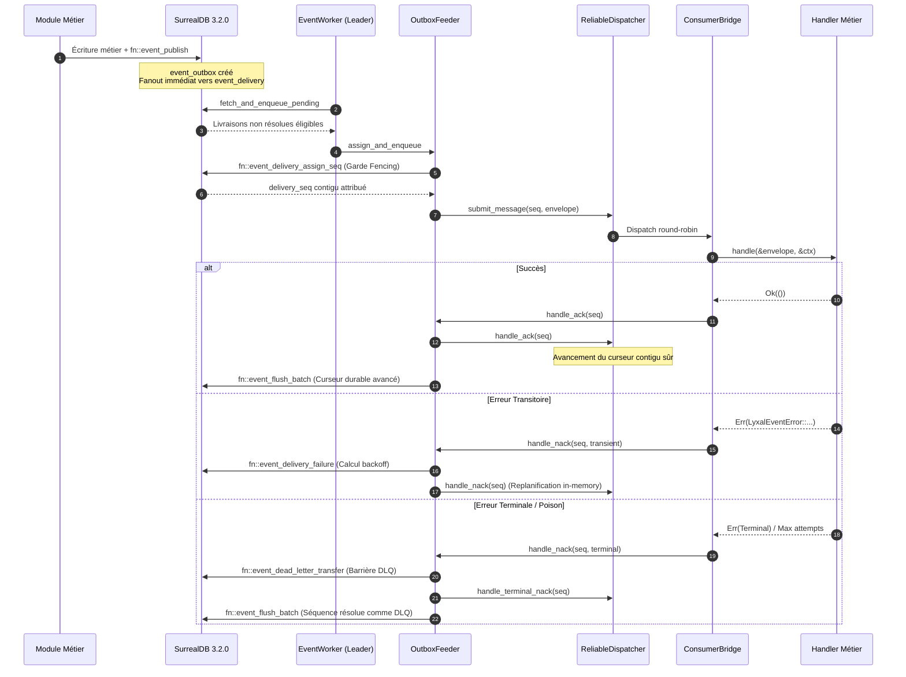

# 🏛️ Architecture Technique Détaillée — LYXAL Event Engine

## 1. Vue d'Ensemble & Pipeline Événementiel

Le **LYXAL Event Engine** concilie la durabilité stricte du stockage base de données (SurrealDB 3.2.0) avec les performances et la flexibilité d'un dispatcher in-process asynchrone pipeliné.



---

## 2. Invariants de Sûreté & Fencing

### 2.1. Bail Distribué (`event_stream_lease:outbox_leader`)
Pour éliminer tout risque de double dispatching ou d'écritures concurrentes désordonnées, le streaming outbox requiert l'acquisition préalable d'un bail unique sous exclusion mutuelle :
* **`owner_node_id`** : Identifiant unique de l'instance possédant le bail.
* **`generation`** : Compteur strictement monotone incrémenté à chaque nouvelle prise de leadership.
* **`expires_at`** : Échéance du bail. Renouvelé à intervalle régulier (heartbeat).
* **`is_released`** : Drapeau autorisant une bascule immédiate sans attendre l'expiration du TTL.

### 2.2. Garde Transactionnelle Conditionnelle
Chaque fonction de mutation de progression (`fn::event_delivery_assign_seq`, `fn::event_flush_batch`, `fn::event_dead_letter_transfer`) applique la garde transactionnelle sur le bail :
```surql
LET $guard = (
    UPDATE event_stream_lease:outbox_leader SET
        last_flushed_at = time::now()
    WHERE id = event_stream_lease:outbox_leader
      AND generation = $generation
      AND owner_node_id = $node_id
      AND is_released = false
      AND expires_at >= time::now()
    RETURN AFTER
);

IF array::len($guard) == 0 {
    THROW "EVENT_STALE_LEADER_FENCED";
};
```
Si un autre nœud a acquis une génération supérieure ou si le bail est expiré, la mutation est immédiatement avortée par SurrealDB, protégeant l'intégrité des curseurs.

---

## 3. Reprise après Crash (Crash Recovery Protocol)

Lors d'un arrêt brutal (panne réseau, interruption du processus, arrêt forcé du serveur) :
1. **État persistant intègre** : Les livraisons déjà confirmées par `fn::event_flush_batch` ont leur statut persistant `delivered` et le curseur `last_persisted_cursor` reflète exactement la dernière séquence contiguë confirmée.
2. **Reprise des livraisons en vol** :
   * Les livraisons qui étaient en cours de traitement (`status = "processing"`) ont un verrou `locked_until` expirant après 30 secondes.
   * Dès redémarrage ou élection d'un nouveau leader, `fetch_and_enqueue_pending` sélectionne ces enregistrements expirés sans leur réattribuer un nouveau `delivery_seq`.
   * Le dispatcher in-process réinjecte le message avec son numéro de séquence d'origine.
   * L'exécution du handler s'exécute, acquitte le message et permet au curseur de reprendre son avancement sans aucun trou ni désynchronisation.

---

## 4. Gestion de la Backpressure & Machine à États

Le `ReliableDispatcher` maintient une fenêtre glissante de capacité maximale configurable (`max_unacked` / `in_flight_count`) :
* Lorsque la fenêtre est pleine, `dispatcher.has_capacity()` renvoie `false`.
* `OutboxFeeder` stoppe immédiatement l'extraction de nouveaux événements depuis SurrealDB.
* La consommation reprend dès qu'un acquittement (`ACK` ou résolution terminale `DLQ`/`Drop`) libère une place dans la fenêtre.

```text
               ┌───────────────┐
               │    PENDING    │
               └───────┬───────┘
                       │ assign_and_enqueue
                       ▼
               ┌───────────────┐
         ┌────►│  DISPATCHED   │◄────┐
         │     └───────┬───────┘     │
         │             │             │
   Retry │        NACK │ ACK         │ Retry
Scheduled│             │             │ Now
         │     ┌───────┴───────┐     │
         └─────┤ IN_FLIGHT_RES │─────┘
               └───────┬───────┘
                       │ Exhausted / Terminal
                       ▼
               ┌───────────────┐
               │  DEAD_LETTER  │
               │   ou DROPPED  │
               └───────┬───────┘
                       │ Flush
                       ▼
               ┌───────────────┐
               │   COMMITTED   │ (Curseur avancé)
               └───────────────┘
```

