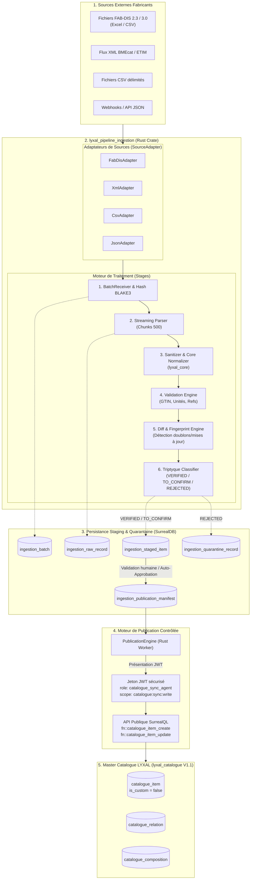

# 🏭 DOCUMENT DE CONCEPTION TECHNIQUE — LYXAL PIPELINE INGESTION V1
## Moteur Industriel d'Ingestion, Normalisation et Qualification Fabricants

> **Statut :** Document de conception soumis pour validation CTO  
> **Auteur :** Antigravity (Advanced Agentic Coding)  
> **Cible :** `crates/lyxal_pipeline_ingestion`  
> **Environnement cible :** Rust 1.80+ / SurrealDB v3.2.0  
> **Dépendances architecturales :** `lyxal_core`, `lyxal_error`, `lyxal_surreal`, `lyxal_event`, `lyxal_runtime`, `lyxal_crypto`, `lyxal_base`  
> **Cible de publication :** `lyxal_catalogue` (Master Catalogue V1.1 scellé)

---

## 1. Vision, Objectifs & Principes Directeurs

### 1.1. Raison d'Être
Le Master Catalogue de Lyxal OS (`lyxal_catalogue`) constitue le référentiel central universel de produits, services et ouvrages du BTP. Sa valeur réside dans sa **pureté normative, son intégrité relationnelle et son immuabilité multi-tenant**.  
L'intégration de catalogues de fabricants mondiaux (ex: Saint-Gobain Placo, Knauf, Siniat, Isover, Legrand, Schneider) confronte le système à des volumes massifs (dizaines de milliers de lignes), des formats hétérogènes (FAB-DIS, BMEcat XML, CSV, API JSON) et des anomalies récurrentes (mauvais GTIN, unités non standardisées, conditionnements incomplets, doublons).

Le module `lyxal_pipeline_ingestion` est un **moteur Rust asynchrone modulaire, découplé du cœur du catalogue**, chargé de :
1. **Ingérer** des flux volumineux sans impacter les performances transactionnelles du catalogue.
2. **Isoler** immédiatement les données brutes dans une zone tampon étanche (*Staging*).
3. **Contrôler et qualifier** les données selon des critères rigoureux (GTIN-13 Modulo 10, unités, conditionnements, références fabricant).
4. **Mettre en quarantaine** toute donnée anormale avec diagnostic précis (*Quarantine*).
5. **Préparer une publication contrôlée** vers le Master Catalogue, sans activation automatique, via l'identité sécurisée `catalogue_sync_agent`.

### 1.2. Les 5 Principes Inviolables
1. **Découplage Absolu :** Le pipeline vit dans son propre crate (`crates/lyxal_pipeline_ingestion`) et sa propre zone de données. Il n'a aucune dépendance sur les détails internes de `lyxal_catalogue`.
2. **Zéro Écriture Directe dans le Master :** Le pipeline ne modifie jamais directement les tables de `lyxal_catalogue`. Toute publication passe par les contrats publics (`fn::catalogue_item_create`, etc.) sous identité de service avec jeton JWT authentifié.
3. **Idempotence & Reprise sur Coupure :** Chaque lot et chaque ligne possède une empreinte cryptographique BLAKE3. En cas de panne au milieu d'un fichier de 50 000 lignes, la reprise s'effectue exactement au dernier point de contrôle sans duplication.
4. **Triptyque de Qualification :** Aucune donnée n'est publiée sans avoir été explicitement classée en `VERIFIED`. Les doutes sont orientés vers `TO_CONFIRM` (arbitrage humain) et les erreurs vers `REJECTED` (quarantaine).
5. **Sanctuarisation de la Quarantaine BTP :** Les 41 références commerciales de Second Œuvre actuellement en quarantaine restent isolées et servent d'épreuve de validation (*Gold Standard Benchmark*) pour le pipeline.

---

## 2. Architecture Globale & Topologie Système



---

## 3. Réutilisation des Crates Existantes de la Suite Lyxal OS

Conformément à la Charte d'Architecture Lyxal OS, le module ne réinvente aucune fondation technique :

| Crate Existant | Rôle & Réutilisation dans `lyxal_pipeline_ingestion` |
| :--- | :--- |
| **`lyxal_core`** | • `lyxal_core/validation` : validation des formats, chaînes, codes et types.<br>• `lyxal_core/sanitize` : canonicalisation des chaînes, suppression des caractères invisibles, trim, majuscules.<br>• `lyxal_core/utils` : comparaisons de dates, manipulations de collections, calculs d'arrondis. |
| **`lyxal_base`** | • Référentiel des unités officielles (`base_unite:PCE`, `M2`, `ML`, `KG`, `LTR`, etc.).<br>• Table de conversion pour transcrire les abréviations fabricants hétérogènes en unités Lyxal standardisées. |
| **`lyxal_error`** | • Contrat universel `LyxalResult<T>`, `LyxalError`, `LyxalCallError`.<br>• Création des codes d'erreurs d'ingestion standardisés (`INGESTION_GTIN_INVALID`, `INGESTION_PARSE_ERROR`, etc.).<br>• Classification standardisée : `retryable`, sévérité, statut HTTP. |
| **`lyxal_crypto`** | • Calcul de hachage BLAKE3 ou SHA-256 ultra-rapide pour l'empreinte de lot (*Batch Fingerprint*) et l'empreinte de ligne (*Row Fingerprint*).<br>• Vérification d'intégrité des documents techniques (PDF, FDES) par checksum. |
| **`lyxal_event`** | • Publication des événements du cycle d'ingestion via `EventPublisher` / `event_outbox` : `ingestion.batch.received`, `ingestion.item.validated`, `ingestion.item.quarantined`, `ingestion.publication.staged`.<br>• Découplage complet des alertes et des notifications vers les Data Stewards. |
| **`lyxal_runtime`** | • Implémentation du trait `LyxalModule` (`manifest.toml`, cycle de vie `install`, `start`, `stop`).<br>• Implémentation de `LyxalWorker` pour les daemons de traitement continu des lots (`IngestionBatchWorker`) avec `CancellationToken` et `RestartPolicy`.<br>• Implémentation de `HealthCheck` pour superviser la file d'attente d'ingestion. |
| **`lyxal_surreal`** | • Façade unifiée `LyxalSurrealCall` (`store.call_fn(...)`) sur `Surreal<Any>`. |

---

## 4. Modèle de Persistance SurrealDB (Zone Staging & Quarantaine)

Le pipeline dispose d'un espace de stockage isolé (`namespace: lyxal_ingestion`, `database: staging_db`), évitant toute contention ou pollution de la base de production.

### 4.1. `ingestion_batch` (Métadonnées de Lot)
Enregistre chaque fichier ou flux entrant avec son empreinte globale et son cycle d'exécution.
```surql
DEFINE TABLE OVERWRITE ingestion_batch TYPE NORMAL SCHEMAFULL
    PERMISSIONS FOR select, create, update, delete WHERE $token.role = "ingestion_admin" OR $token.role = "catalogue_sync_agent";

DEFINE FIELD OVERWRITE source_type ON TABLE ingestion_batch TYPE string ASSERT $value IN ["FAB_DIS", "CSV", "XML", "JSON"];
DEFINE FIELD OVERWRITE fournisseur_id ON TABLE ingestion_batch TYPE string;
DEFINE FIELD OVERWRITE nom_fichier ON TABLE ingestion_batch TYPE string;
DEFINE FIELD OVERWRITE file_hash_blake3 ON TABLE ingestion_batch TYPE string;
DEFINE FIELD OVERWRITE taille_octets ON TABLE ingestion_batch TYPE int;
DEFINE FIELD OVERWRITE statut ON TABLE ingestion_batch TYPE string 
    DEFAULT "RECEIVED"
    ASSERT $value IN ["RECEIVED", "PARSING", "VALIDATING", "STAGED", "PUBLISHED", "FAILED"];
DEFINE FIELD OVERWRITE total_lignes ON TABLE ingestion_batch TYPE int DEFAULT 0;
DEFINE FIELD OVERWRITE lignes_verifiees ON TABLE ingestion_batch TYPE int DEFAULT 0;
DEFINE FIELD OVERWRITE lignes_a_confirmer ON TABLE ingestion_batch TYPE int DEFAULT 0;
DEFINE FIELD OVERWRITE lignes_rejetees ON TABLE ingestion_batch TYPE int DEFAULT 0;
DEFINE FIELD OVERWRITE created_at ON TABLE ingestion_batch TYPE datetime VALUE time::now();
DEFINE FIELD OVERWRITE completed_at ON TABLE ingestion_batch TYPE option<datetime>;

DEFINE INDEX OVERWRITE idx_batch_hash ON TABLE ingestion_batch FIELDS file_hash_blake3 UNIQUE;
```

### 4.2. `ingestion_raw_record` (Zone Tampon Brute)
Conserve la ligne brute telle qu'extraite de la source, assurant la traçabilité intégrale et la relecture en cas de mise à jour des règles d'analyse.
```surql
DEFINE TABLE OVERWRITE ingestion_raw_record TYPE NORMAL SCHEMAFULL;

DEFINE FIELD OVERWRITE batch ON TABLE ingestion_raw_record TYPE record<ingestion_batch>;
DEFINE FIELD OVERWRITE ligne_numero ON TABLE ingestion_raw_record TYPE int;
DEFINE FIELD OVERWRITE row_hash ON TABLE ingestion_raw_record TYPE string;
DEFINE FIELD OVERWRITE payload_brut ON TABLE ingestion_raw_record TYPE object;
DEFINE FIELD OVERWRITE created_at ON TABLE ingestion_raw_record TYPE datetime VALUE time::now();

DEFINE INDEX OVERWRITE idx_raw_batch_line ON TABLE ingestion_raw_record FIELDS batch, ligne_numero UNIQUE;
```

### 4.3. `ingestion_staged_item` (Articles Normalisés en Staging)
Articles extraits, nettoyés, enrichis et classifiés.
```surql
DEFINE TABLE OVERWRITE ingestion_staged_item TYPE NORMAL SCHEMAFULL;

DEFINE FIELD OVERWRITE batch ON TABLE ingestion_staged_item TYPE record<ingestion_batch>;
DEFINE FIELD OVERWRITE raw_record ON TABLE ingestion_staged_item TYPE record<ingestion_raw_record>;
DEFINE FIELD OVERWRITE row_fingerprint ON TABLE ingestion_staged_item TYPE string;

-- Données pivots d'identification
DEFINE FIELD OVERWRITE code_barre_gtin ON TABLE ingestion_staged_item TYPE option<string>;
DEFINE FIELD OVERWRITE fabricant ON TABLE ingestion_staged_item TYPE string;
DEFINE FIELD OVERWRITE marque ON TABLE ingestion_staged_item TYPE option<string>;
DEFINE FIELD OVERWRITE reference_fabricant ON TABLE ingestion_staged_item TYPE string;

-- Caractéristiques descriptives normalisées
DEFINE FIELD OVERWRITE libelle_commercial ON TABLE ingestion_staged_item TYPE string;
DEFINE FIELD OVERWRITE description_technique ON TABLE ingestion_staged_item TYPE option<string>;
DEFINE FIELD OVERWRITE type_item ON TABLE ingestion_staged_item TYPE string DEFAULT "PRODUIT";
DEFINE FIELD OVERWRITE unite_reference ON TABLE ingestion_staged_item TYPE string; -- Code base_unite
DEFINE FIELD OVERWRITE conditionnement ON TABLE ingestion_staged_item TYPE object;

-- Classification et état
DEFINE FIELD OVERWRITE qualification ON TABLE ingestion_staged_item TYPE string
    ASSERT $value IN ["VERIFIED", "TO_CONFIRM", "REJECTED"];
DEFINE FIELD OVERWRITE publication_action ON TABLE ingestion_staged_item TYPE string
    ASSERT $value IN ["INSERT", "UPDATE", "UNCHANGED", "DEPRECATE"];
DEFINE FIELD OVERWRITE diff_payload ON TABLE ingestion_staged_item TYPE option<object>;
DEFINE FIELD OVERWRITE is_approved ON TABLE ingestion_staged_item TYPE bool DEFAULT false;
DEFINE FIELD OVERWRITE approved_by ON TABLE ingestion_staged_item TYPE option<string>;
DEFINE FIELD OVERWRITE approved_at ON TABLE ingestion_staged_item TYPE option<datetime>;
```

### 4.4. `ingestion_quarantine_record` (Zone de Quarantaine & Audit d'Erreurs)
Journalise chaque anomalie détectée avec son contexte, la valeur fautive et le code d'erreur standardisé `lyxal_error`.
```surql
DEFINE TABLE OVERWRITE ingestion_quarantine_record TYPE NORMAL SCHEMAFULL;

DEFINE FIELD OVERWRITE batch ON TABLE ingestion_quarantine_record TYPE record<ingestion_batch>;
DEFINE FIELD OVERWRITE raw_record ON TABLE ingestion_quarantine_record TYPE record<ingestion_raw_record>;
DEFINE FIELD OVERWRITE code_erreur ON TABLE ingestion_quarantine_record TYPE string;
DEFINE FIELD OVERWRITE severite ON TABLE ingestion_quarantine_record TYPE string ASSERT $value IN ["CRITICAL", "ERROR", "WARNING"];
DEFINE FIELD OVERWRITE champ_concerne ON TABLE ingestion_quarantine_record TYPE string;
DEFINE FIELD OVERWRITE valeur_fautive ON TABLE ingestion_quarantine_record TYPE option<any>;
DEFINE FIELD OVERWRITE cause_detaillee ON TABLE ingestion_quarantine_record TYPE string;
DEFINE FIELD OVERWRITE created_at ON TABLE ingestion_quarantine_record TYPE datetime VALUE time::now();

DEFINE INDEX OVERWRITE idx_quarantine_batch ON TABLE ingestion_quarantine_record FIELDS batch, severite;
```

### 4.5. `ingestion_publication_manifest` (Manifeste de Publication Staged)
Ensemble scellé d'articles approuvés prêt pour injection vers `lyxal_catalogue`.
```surql
DEFINE TABLE OVERWRITE ingestion_publication_manifest TYPE NORMAL SCHEMAFULL;

DEFINE FIELD OVERWRITE batch ON TABLE ingestion_publication_manifest TYPE record<ingestion_batch>;
DEFINE FIELD OVERWRITE manifest_ref ON TABLE ingestion_publication_manifest TYPE string;
DEFINE FIELD OVERWRITE nb_articles_insert ON TABLE ingestion_publication_manifest TYPE int;
DEFINE FIELD OVERWRITE nb_articles_update ON TABLE ingestion_publication_manifest TYPE int;
DEFINE FIELD OVERWRITE statut ON TABLE ingestion_publication_manifest TYPE string
    DEFAULT "READY"
    ASSERT $value IN ["READY", "EXECUTING", "COMMITTED", "FAILED"];
DEFINE FIELD OVERWRITE execution_log ON TABLE ingestion_publication_manifest TYPE option<array<object>>;
DEFINE FIELD OVERWRITE executed_at ON TABLE ingestion_publication_manifest TYPE option<datetime>;
```

---

## 5. Architecture des Structures & Traits Rust

### 5.1. Trait `SourceAdapter` (Extensibilité des Formats)
```rust
use async_trait::async_trait;
use tokio::io::AsyncRead;
use crate::error::IngestionResult;
use crate::models::{RawRecord, SourceFormat};
use futures::Stream;
use std::pin::Pin;

pub type RawRecordStream = Pin<Box<dyn Stream<Item = IngestionResult<RawRecord>> + Send>>;

#[async_trait]
pub trait SourceAdapter: Send + Sync {
    /// Identifie le format géré par l'adaptateur
    fn format(&self) -> SourceFormat;

    /// Valide l'en-tête ou la structure globale du fichier avant extraction
    async fn validate_header(&self, sample: &[u8]) -> IngestionResult<()>;

    /// Parse le flux de manière asynchrone et produit un stream d'enregistrements bruts
    async fn parse_stream(
        &self, 
        reader: Box<dyn AsyncRead + Unpin + Send>
    ) -> IngestionResult<RawRecordStream>;
}
```

### 5.2. Adaptateur FAB-DIS (`FabDisAdapter`)
FAB-DIS est le standard d'échange de données produits du BTP. L'adaptateur gère les versions 2.3 et 3.0 en consommant les 4 segments fonctionnels :
```rust
pub struct FabDisAdapter;

pub struct FabDisRow {
    // Segment COMMERCE
    pub ean_code: Option<String>,
    pub manufacturer_ref: String,
    pub brand_name: String,
    pub commercial_label: String,
    pub sales_unit: String,
    pub min_order_qty: f64,
    pub multiple_order_qty: f64,
    pub weight_kg: Option<f64>,
    pub dimensions: Option<Dimensions>,
    
    // Segment MEDIA
    pub technical_sheet_url: Option<String>,
    pub photo_hd_url: Option<String>,
    pub certificate_fdes_url: Option<String>,
    
    // Segment TECHNIQUE (ETIM)
    pub etim_class_code: Option<String>,
    pub etim_attributes: Vec<EtimAttribute>,
    
    // Segment REGLEMENTAIRE
    pub has_ce_marking: bool,
    pub reach_status: Option<String>,
    pub rep_eco_tax: Option<f64>,
}
```

### 5.3. Moteur de Validation & Règles Métier (`ValidationEngine`)
```rust
#[async_trait]
pub trait ValidationRule: Send + Sync {
    fn code(&self) -> &'static str;
    async fn validate(&self, item: &StagedItemCandidate) -> RuleOutcome;
}

pub enum RuleOutcome {
    Passed,
    ToConfirm { warning_code: String, reason: String },
    Rejected { error_code: String, field: String, details: String },
}
```

Règles de validation implémentées :
1. `GtinModulo10Rule` : Vérifie la clé de contrôle GS1 Modulo 10 pour tout code GTIN à 13 chiffres via réutilisation de `lyxal_core` ou algorithme cryptographique natif.
2. `ManufacturerUniquenessRule` : Contrôle la présence obligatoire du couple `(fabricant, reference_fabricant)`.
3. `BaseUnitConsistencyRule` : Rapproche l'unité fournisseur avec le dictionnaire `base_unite` (`lyxal_base`).
4. `PackagingPhysicalCoherenceRule` : Vérifie que `quantite > 0`, `poids_kg > 0`, et que les dimensions (`L`, `l`, `H`) sont positives et réalistes.
5. `MediaUrlSafetyRule` : Vérifie la validité syntaxique de l'URL, l'usage du protocole sécurisé HTTPS et les types MIME attendus.

### 5.4. Moteur de Détection de Différences & Empreintes (`FingerprintEngine`)
Pour garantir l'idempotence et optimiser les mises à jour différentielles :
```rust
pub struct FingerprintEngine;

impl FingerprintEngine {
    /// Calcule le hash du lot complet (BLAKE3) pour éviter le traitement multiple du même fichier
    pub fn compute_batch_hash(data: &[u8]) -> String {
        let hash = blake3::hash(data);
        hash.to_hex().to_string()
    }

    /// Calcule l'empreinte sémantique de l'article pour détecter les modifications réelles
    pub fn compute_row_fingerprint(item: &StagedItemCandidate) -> String {
        let mut hasher = blake3::Hasher::new();
        hasher.update(item.fabricant.to_uppercase().trim().as_bytes());
        hasher.update(item.reference_fabricant.to_uppercase().trim().as_bytes());
        if let Some(gtin) = &item.code_barre_gtin {
            hasher.update(gtin.trim().as_bytes());
        }
        hasher.update(item.libelle_commercial.trim().as_bytes());
        hasher.update(item.unite_reference.trim().as_bytes());
        hasher.finalize().to_hex().to_string()
    }
}
```

---

## 6. Flux de Qualification & Gestion de la Quarantaine

```text
               ┌──────────────────────────────┐
               │    Ligne brute extraite      │
               └──────────────┬───────────────┘
                              │
                              ▼
               ┌──────────────────────────────┐
               │  Nettoyage & Normalisation   │ (lyxal_core/sanitize)
               └──────────────┬───────────────┘
                              │
                              ▼
               ┌──────────────────────────────┐
               │     Validation Stricte       │
               └──────────────┬───────────────┘
                              │
        ┌─────────────────────┼─────────────────────┐
        │                     │                     │
  [Anomalie Bloquante]    [Doute / Risque]     [100% Conforme]
        │                     │                     │
        ▼                     ▼                     ▼
┌──────────────┐      ┌──────────────┐      ┌──────────────┐
│   REJECTED   │      │  TO_CONFIRM  │      │   VERIFIED   │
│ (Quarantaine)│      │  (Arbitrage) │      │ (Éligible)   │
└──────┬───────┘      └──────┬───────┘      └──────┬───────┘
       │                     │                     │
       ▼                     ▼                     │
 Journal d'audit      Interface Steward            │
 & motif précis      (Valider / Rejeter)           │
                             │                     │
                             └──────────┬──────────┘
                                        │
                                        ▼
                         ┌─────────────────────────────┐
                         │ Staged Publication Manifest │
                         └──────────────┬──────────────┘
                                        │
                         [Ordre Explicite de Publication]
                                        │
                                        ▼
                         ┌─────────────────────────────┐
                         │  Master Catalogue (V1.1)    │
                         └─────────────────────────────┘
```

### Matrice de Qualification
| Critère | `VERIFIED` | `TO_CONFIRM` | `REJECTED` |
| :--- | :--- | :--- | :--- |
| **Code GTIN / EAN-13** | Valide avec clé Modulo 10 vérifiée. | Absent (pour pièces sur mesure/spécifiques). | Invalide (clé fausse, lettres, mauvaise longueur). |
| **Référence Fabricant** | Renseignée et format standard. | Similitude détectée avec une référence existante. | Absente ou vide. |
| **Marque / Fabricant** | Conforme au référentiel constructeur. | Nouveau fabricant non encore répertorié. | Incohérent ou vide pour un produit commercial. |
| **Unité de Vente** | Correspondance exacte dans `base_unite`. | Unité convertible nécessitant ratio spécifique. | Unité inconnue ou inexploitable. |
| **Conditionnement** | Poids et dimensions cohérents. | Poids ou dimensions manquants sur un produit volumineux. | Valeurs négatives ou absurdes. |

---

## 7. Moteur de Publication Contrôlée & Non-Activation Automatique

### 7.1. Le Principe de Séparation Temporelle (Staging vs Commit)
L'ingestion ne publie **JAMAIS** en base de production de manière synchrone ou automatique :
1. L'ingestion se conclut par l'écriture d'un `ingestion_publication_manifest` à l'état `READY`.
2. Le Data Steward (ou un pipeline CI/CD de catalogue) examine le résumé :
   - Nombre de créations (`INSERT`).
   - Nombre de mises à jour de fiches existantes (`UPDATE`).
   - Taux de rejet en quarantaine.
3. Le Data Steward déclenche l'exécution du manifeste.

### 7.2. Intégration Sécurisée avec `lyxal_catalogue`
Pour respecter le scellement et les restrictions RLS de `lyxal_catalogue` V1.1 :
* Le worker `PublicationEngine` s'authentifie via `lyxal_auth` pour obtenir un jeton JWT de service :
  ```json
  {
    "iss": "lyxal-os",
    "aud": "lyxal-catalogue",
    "sub": "service:pipeline-ingestion-worker",
    "role": "catalogue_sync_agent",
    "scope": ["catalogue:sync:write"],
    "exp": 1730003600
  }
  ```
* Il appelle les procédures officielles :
  - `fn::catalogue_item_create` pour les nouvelles références maîtresses.
  - `fn::catalogue_item_update` pour les enrichissements techniques.
* **Garantie de non-écrasement des personnalisations locales :**
  Conformément aux tests `CTO-TEST-5A` et `5B` de `lyxal_catalogue`, les champs locaux (`enabled`, `libelle_personnalise`, `code_interne_client`) ne sont jamais écrasés par le flux d'ingestion.

---

## 8. Plan de Validation & Benchmark sur les 41 Références BTP en Quarantaine

### 8.1. Sanctuarisation
Le fichier [`crates/lyxal_catalogue/seeds/btp_lot1_commercial.surql`](file:///c:/Users/HP/Desktop/Lyxal_OS/crates/lyxal_catalogue/seeds/btp_lot1_commercial.surql) contient 41 références réelles de Second Œuvre / Cloisons (Saint-Gobain Placo, Knauf France, Siniat, Isover, Semin, Spit Paslode).  
Ce fichier reste strictement exclu du Master Catalogue tant que le pipeline d'ingestion n'a pas validé son épreuve de qualification.

### 8.2. L'Épreuve de Qualification Industrielle (Benchmark Ingestion)
1. Les 41 références sont extraites et converties au format FAB-DIS / CSV standard.
2. Le pipeline `lyxal_pipeline_ingestion` ingère le lot test.
3. Critères d'acceptation de l'épreuve :
   - **Taux de parsing :** 100 % (41/41).
   - **Taux de qualification `VERIFIED` :** 100 % (41/41 avec GTIN Modulo 10 vérifiés et unités rapprochées de `base_unite`).
   - **Taux de rejet en quarantaine :** 0 %.
   - **Idempotence :** Un second passage immédiat du même lot produit 41 `UNCHANGED` et 0 doublon.
4. Ce n'est qu'après la validation de ce benchmark par le CTO que les 41 références pourront être publiées dans le Master Catalogue via le manifeste contrôlé.

---

## 9. Plan d'Implémentation par Étapes (Phases 1 à 5)

| Phase | Intitulé & Objectif | Livrables Principaux |
| :---: | :--- | :--- |
| **Phase 1** | **Création du Crate & Modèle SurrealDB** | • `crates/lyxal_pipeline_ingestion/Cargo.toml` et `manifest.toml`<br>• Schémas SurrealDB (`ingestion_batch`, `ingestion_raw_record`, `ingestion_staged_item`, `ingestion_quarantine_record`, `ingestion_publication_manifest`)<br>• Codes d'erreurs `lyxal_error` dans `error/ingestion/` |
| **Phase 2** | **Adaptateurs de Sources & Streaming** | • Trait `SourceAdapter`<br>• `FabDisAdapter` (support CSV/Excel FAB-DIS 2.3 & 3.0)<br>• `CsvAdapter` (délimiteur et mapping dynamique)<br>• `JsonAdapter` pour les webhooks API |
| **Phase 3** | **Moteur de Validation & Quarantaine** | • Pipeline de validation (`GtinModulo10Rule`, `BaseUnitRule`, `PackagingRule`)<br>• Calculateur d'empreintes BLAKE3 (`FingerprintEngine`)<br>• Routeur de qualification (`VERIFIED`, `TO_CONFIRM`, `REJECTED`)<br>• Journalisation des anomalies en quarantaine |
| **Phase 4** | **Publication Contrôlée & Worker Runtime** | • Intégration `LyxalWorker` supervisé (`IngestionWorker`)<br>• Générateur de manifestes (`PublicationEngine`)<br>• Client d'injection sécurisé `catalogue_sync_agent` avec JWT |
| **Phase 5** | **Benchmark BTP 41 & Recette Globale** | • Script de test de bout en bout sur les 41 références de quarantaine<br>• Tests de robustesse (fichiers corrompus, GTIN erronés, reprise sur coupure)<br>• Rapport de recette et soumission CTO pour mise en service |

---

## 10. Conclusion & Demande de Validation CTO

Le présent document garantit une étanchéité absolue entre la réception des données fabricants et le Master Catalogue LYXAL V1.1. Aucune régression, altération de schéma ou pollution du catalogue maître n'est possible.

**Action attendue du CTO :** Validation formelle du document de conception technique pour autoriser le passage à la Phase 1 (Création du Crate et Schémas Staging).
